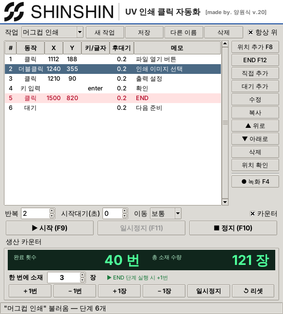

# UV 인쇄 클릭 자동화 [made by. 양원식 v.20] (`uv-click-macro/`)

UV 인쇄기 프로그램에서 매번 하는 "이동 → 클릭 → 이동 → 클릭"을 저장해 두었다가
**[▶ 시작] (또는 F9)** 한 번으로 그대로 실행하는 윈도우용 프로그램입니다.
작업(제품)별로 여러 개 저장해서 골라 쓸 수 있습니다.

## 다운로드 (설치 없이 바로 실행 — 추천)

[릴리스 페이지](https://github.com/bigyws/Save/releases/tag/uv-click-macro-latest)에서 **`UV-Click-Macro.exe`** 를 받아 더블클릭하면 됩니다. Python 설치가 필요 없습니다.
exe를 바탕화면의 전용 폴더(예: `UV자동화`)에 두고 쓰세요. 작업은 exe 옆 `macros` 폴더에 저장됩니다.

## 직접 설치해서 실행 (Python 사용)

1. https://www.python.org 에서 Python 설치 — 설치 첫 화면에서 **"Add python.exe to PATH" 체크**
2. 이 폴더에서 `1_install.bat` 더블클릭
3. 이후로는 `2_run.bat` 더블클릭으로 실행

> 파이썬 없는 다른 PC에서 쓰려면 `3_make_exe.bat` → 생기는 `dist\UV-Click-Macro.exe` 하나만 복사하면 됩니다.

## 사용법

### 방법 A. 위치 찍기 (추천)
1. **[새 작업]** → 이름 입력 (예: `머그컵 인쇄`)
2. 인쇄 프로그램에서 누를 버튼 위에 마우스를 올리고 **F8** → 그 위치가 '클릭' 단계로 추가
3. 순서대로 반복해서 F8
4. 각 단계 더블클릭 → **"실행 후 대기(초)"** 를 프로그램 반응 속도에 맞게 조정, 메모 입력
5. **[저장]**

### 방법 B. 클릭 녹화
**F4** (또는 [● 녹화 F4]) → 창이 내려가면 평소처럼 클릭 → **F4** 한 번 더 누르면 끝 (창이 다시 보임).
클릭 위치와 클릭 사이 간격이 그대로 기록됩니다 (같은 곳 빠르게 두 번은 더블클릭으로 기록).
녹화 후 목록에서 필요 없는 단계를 지우거나 대기시간을 다듬으세요.

### 실행
작업 선택 → 반복 횟수 → **[▶ 시작] / F9**.
"시작 전 대기(초)" 동안 인쇄 프로그램 창을 앞에 띄워 두면 됩니다.

| 단축키 | 기능 |
|---|---|
| F4 | 클릭 녹화 시작 / 다시 누르면 녹화 끝 (녹화 중엔 창이 내려가고, 끝나면 다시 보임) |
| F8 | 현재 마우스 위치를 클릭 단계로 추가 |
| F12 | 단계에 **END** 표시 / 다시 누르면 END 해제 (단계는 추가되지 않음) |
| F9 | 시작 |
| F10 | 정지 / 녹화 끝 |
| F11 | 일시정지 / 계속 |
| ESC | 실행 중 정지 |
| 마우스를 화면 **왼쪽 위 구석**으로 | 비상정지 |

실행 중 **[일시정지] (F11)** 를 누르면 그 자리에서 멈추고, **[▶ 계속]** 을 누르면 이어서 진행합니다 (대기 시간도 멈춘 만큼 늘어납니다).

### 생산 카운터 (횟수 × 소재 수량)
- **"한 번에 소재 ○장"** 에 한 번에 들어가는 소재 수를 적습니다 (작업마다 따로 저장됨).
- **F12** 를 누르면 단계에 END 가 붙고, 다시 누르면 없어집니다. **단계(번호)는 새로 생기지 않습니다.**
  END 가 붙는 단계: ① 마우스가 올라가 있는 위치의 단계 → ② 없으면 목록에서 선택한 단계 → ③ 없으면 마지막 단계. 녹화 중에는 방금 클릭한 단계.
- 또는 단계의 **메모에 `END`** 라고 적으면, 그 단계가 실행될 때 **한 번 끝 → +1번** 으로 셉니다. (목록에서 빨간 줄로 표시)
- 화면 오른쪽에 **총 소재 수량** (한 번에 소재 × 완료 횟수)이 계산되어 나옵니다.
- 메모에 END 가 하나도 없으면 **세지 않습니다** (화면에 빨간 글씨로 안내가 나옵니다).
- **[일시정지]**: 자동으로 세지 않음 (테스트할 때) → **[▶ 다시 세기]**
- **[＋1번] / [－1번]**: 횟수를 손으로 더하고 빼기
- **[＋1장] / [－1장]**: 총 소재 수량만 따로 더하고 빼기 (불량·추가분 등)
- **[↺ 리셋]**: 횟수와 총 수량 모두 0으로
- 숫자는 프로그램을 껐다 켜도 남아 있습니다.

### 단계 종류
- **클릭 / 더블클릭 / 오른쪽클릭 / 마우스이동**: 좌표 위치에서 실행
- **대기**: 그냥 기다리기 (예: 인쇄 준비, 파일 로딩)
- **키 입력**: `enter`, `tab`, `esc`, `f5`, `ctrl+s`, `alt+f4` 같은 키
- **글자 입력**: 파일명·수량 등 글자 입력 (한글 가능)
- **[위치 확인]**: 선택한 단계 위치로 마우스만 옮겨서 맞는지 확인 (클릭 안 함)

## 회사 로고 바꾸기
`logo.png` 파일을 exe 와 같은 폴더에 넣으면 맨 위 기본 SHINSHIN 로고 대신 그 그림이 나옵니다 (높이가 크면 자동으로 줄어듭니다).
기본 로고와 아이콘은 `assets/` 폴더에 있습니다.

## 꼭 지켜야 할 것 (좌표 방식이라)
- 인쇄 프로그램 창을 **항상 같은 위치·같은 크기(최대화 추천)** 로 두세요.
- 모니터 해상도·배율을 바꾸면 위치를 다시 찍어야 합니다.
- 저장한 작업은 `macros` 폴더에 `작업이름.json` 으로 저장됩니다 (복사해서 다른 PC로 옮기기 가능).
- 기계가 실제로 움직이는 동작(인쇄 시작 등) 전에는 대기를 넉넉히 두고, 처음엔 반복 1회로 지켜보며 테스트하세요.

## 업그레이드 내역

프로그램 맨 위 **[made by. 양원식 v.○○]** 를 누르면 프로그램 안에서도 볼 수 있습니다.

| 버전 | 날짜 | 내용 |
|---|---|---|
| v.20 | 11/21 | 위쪽 새 작업·저장·다른 이름·삭제 버튼 넓게, 버튼 이름 '녹화 F4' |
| v.19 | 11/21 | 녹화 단축키 F4 로 변경, 버전 표시와 업그레이드 내역 보기 추가 |
| v.18 | 11/21 | 오른쪽 버튼 한 줄 배치, 창 가로 폭 줄이기 |
| v.17 | 11/21 | 컴팩트 화면 적용, 녹화 단축키 F3 |
| v.16 | 11/21 | 녹화 단축키 F7 (한 번 누르면 녹화, 다시 누르면 끝) |
| v.15 | 11/21 | 컴팩트 화면, 후대기 기본 0.2초 |
| v.14 | 11/21 | 총 소재 수량 ＋1장 / －1장 버튼 |
| v.13 | 11/20 | F12 는 번호 추가 없이 END 만 켜기/끄기 |
| v.12 | 11/20 | F12 같은 위치에서 다시 누르면 END 해제 |
| v.11 | 11/20 | F12 로 END 표시 |
| v.10 | 11/20 | 메모에 END 가 없으면 카운트 안 함 |
| v.9 | 11/20 | [made by. 양원식] 표시 |
| v.8 | 11/20 | SHINSHIN 로고, SS 아이콘 |
| v.7 | 11/20 | 맨 위 제목줄 추가 |
| v.6 | 11/20 | 계산식 문구 숨기기, 소리 알림 삭제 |
| v.5 | 11/20 | 카운터 단위 '판' → '번' |
| v.4 | 11/20 | END 메모로 카운트, 한 번에 소재 수량, 계산기 삭제 |
| v.3 | 11/19 | 생산 카운터, 일시정지(F11), 계산기 추가 |
| v.2 | 11/19 | Python 없이 실행되는 exe 파일 |
| v.1 | 11/19 | 실행 파일 이름 정리 (압축 풀 때 글자 깨짐 방지) |
| v.0 | 11/19 | 처음 만듦: 위치 찍기(F8), 클릭 녹화, 작업 저장, 시작/정지 |
